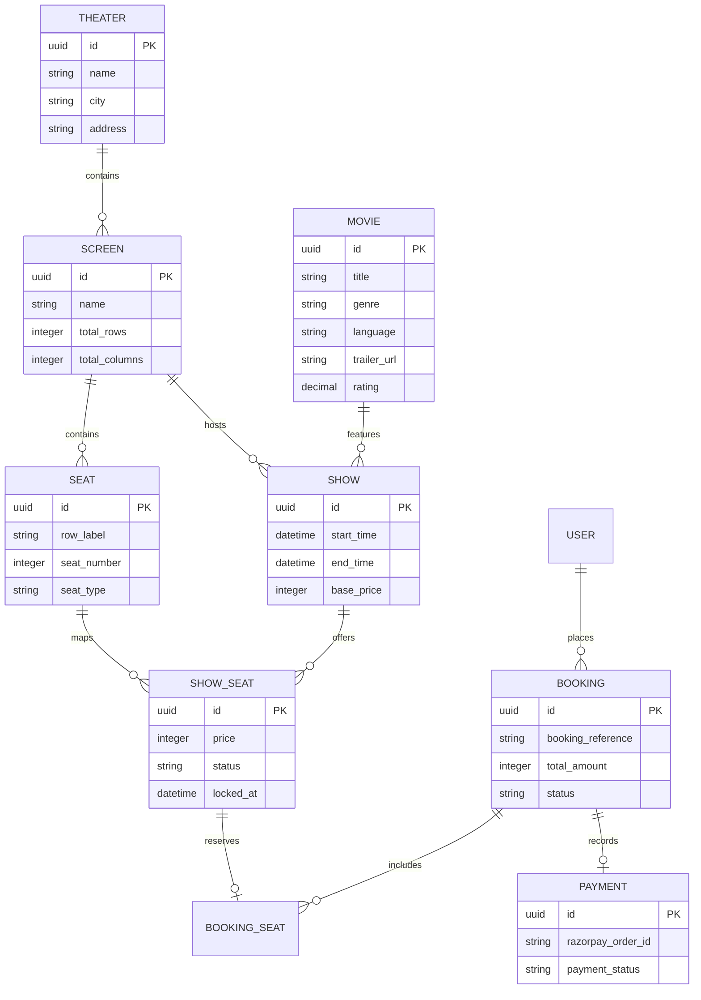
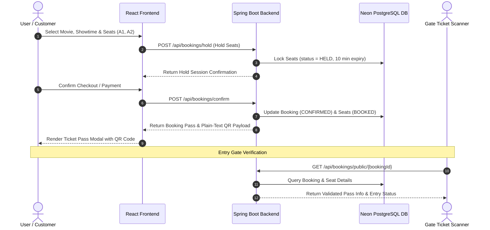
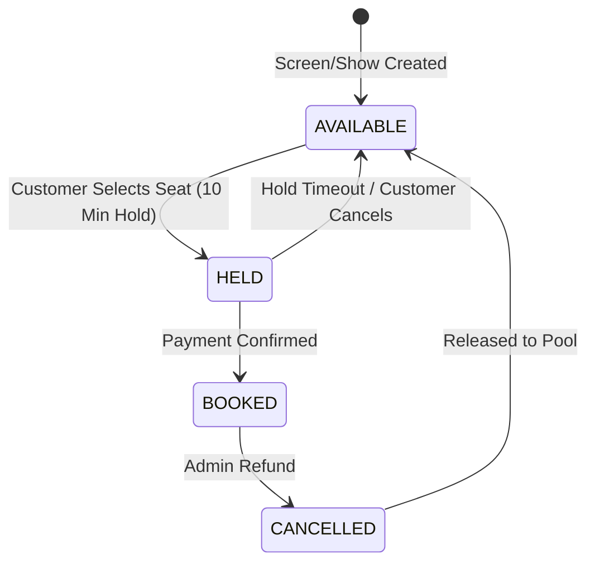

# 🎬 CineBook — Enterprise Movie Ticket Booking & Theater Management Platform

[](https://coruscating-eclair-2724dd.netlify.app/)
[](https://cinebook-api-6cw7.onrender.com)
[](https://www.oracle.com/java/)
[](https://spring.io/projects/spring-boot)
[](https://react.dev/)
[](LICENSE)
[](https://github.com/RishiRaj0128/Cinebook-Movie-Booking-Platform_Rishi_Raj/actions)

> 🌐 **Live Web Application (Netlify):** [https://coruscating-eclair-2724dd.netlify.app/](https://coruscating-eclair-2724dd.netlify.app/)  
> ⚙️ **Production REST API (Render):** [https://cinebook-api-6cw7.onrender.com](https://cinebook-api-6cw7.onrender.com)  
> 📚 **Swagger / OpenAPI Docs:** [https://cinebook-api-6cw7.onrender.com/swagger-ui.html](https://cinebook-api-6cw7.onrender.com/swagger-ui.html)

**CineBook** is a production-ready, full-stack movie ticket reservation and cinema management system engineered for high-concurrency ticket bookings, real-time seat locks, regional cinema discovery, embedded trailer streaming, and automated gate ticket pass validation.

Built with a **Spring Boot 3 (Java 21)** REST backend, **Neon Cloud PostgreSQL**, a **React 18 (TypeScript)** single-page application, and integrated with **Groq AI (Llama 3.3)** for natural language movie recommendations.

---

## 📋 Table of Contents
1. [Executive Summary](#-executive-summary)
2. [Key Capabilities & Features](#-key-capabilities--features)
3. [System Architecture & Tech Stack](#-system-architecture--tech-stack)
4. [Deep-Dive Design Diagrams (Mermaid.js)](#-deep-dive-design-diagrams-mermaidjs)
   - [4.1 High-Level Architecture](#41-high-level-architecture)
   - [4.2 Entity-Relationship (ER) Schema](#42-entity-relationship-er-schema)
   - [4.3 Booking & Gate Verification Sequence](#43-booking--gate-verification-sequence)
   - [4.4 Seat Lock Lifecycle State Machine](#44-seat-lock-lifecycle-state-machine)
5. [Core Business Logic & Algorithms](#-core-business-logic--algorithms)
   - [5.1 Real-Time Seat Hold & Concurrency Control](#51-real-time-seat-hold--concurrency-control)
   - [5.2 Dynamic Tiered Pricing Model](#52-dynamic-tiered-pricing-model)
   - [5.3 Universal QR Gate Pass Engine](#53-universal-qr-gate-pass-engine)
   - [5.4 TMDB Indian Regional Cinema Sync](#54-tmdb-indian-regional-cinema-sync)
6. [Financial Transaction & Payment Engineering (Enterprise Deep Dive)](#-financial-transaction--payment-engineering-enterprise-deep-dive)
   - [6.1 Functional Domain Modeling & Rule Engine](#61-functional-domain-modeling--rule-engine)
   - [6.2 Cryptographic Idempotency](#62-cryptographic-idempotency)
   - [6.3 Concurrency Control & Deadlock-Free Ordering](#63-concurrency-control--deadlock-free-ordering)
   - [6.4 Double-Entry Append-Only Ledger](#64-double-entry-append-only-ledger)
   - [6.5 Strict Finite State Machine](#65-strict-finite-state-machine)
   - [6.6 Smallest Integer Currency Discipline (Paise)](#66-smallest-integer-currency-discipline-paise)
   - [6.7 Saga Pattern & Distributed Compensation](#67-saga-pattern--distributed-compensation)
   - [6.8 Webhook Ingestion & Replay Deduplication](#68-webhook-ingestion--replay-deduplication)
   - [6.9 Induced Failure Recovery & Post-Mortem Log](#69-induced-failure-recovery--post-mortem-log)
7. [REST API Documentation](#-rest-api-documentation)
8. [Security & Authentication Model](#-security--authentication-model)
9. [Repository Directory Structure](#-repository-directory-structure)
10. [Local Development & Setup Guide](#-local-development--setup-guide)
11. [License & Maintainers](#-license--maintainers)

---

## 💡 Executive Summary

CineBook addresses core operational challenges in modern multiplex movie booking:
- **Preventing Double-Booking:** Implements a 10-minute temporary seat hold engine with scheduled lock expiry sweeps.
- **Universal Ticket Pass Verification:** Provides plain-text QR ticket passes compatible with all third-party lenses (Google Lens, iPhone Camera, physical barcode scanners) paired with an unauthenticated public gate verification API (`/api/bookings/public/{id}`).
- **In-App Video Trailer Experience:** Embeds official YouTube 16:9 HD movie trailers directly inside modal windows, completely removing third-party site redirects.
- **Regional Indian Cinema Support:** Synchronizes blockbusters across **Bollywood (Hindi)**, **Tollywood (Telugu)**, **Kollywood (Tamil)**, and **Hollywood (English)**, pre-seeded across 18 Indian metropolitan hubs.

---

## ✨ Key Capabilities & Features

| Capability | Technical Implementation | Business Benefit |
|---|---|---|
| **Universal QR Gate Pass** | Plain-text JSON payload + public verification REST API | Enables 1-second gate verification across any lens or scanner |
| **In-Site HD Trailer Player** | Embedded `<iframe>` stream with fallback dictionary | Zero external redirects; increases user engagement |
| **Real-Time Seat Locks** | Spring `@Scheduled` thread pool + status state machine | Eliminates race conditions during peak ticket booking |
| **Dynamic Tiered Pricing** | Regular, Premium & Recliner multipliers | Maximizes ticket revenue per screening |
| **Groq AI Movie Assistant** | Spring AI + Llama 3.3 70B Engine | Delivers natural language movie recommendations |
| **Regional Cinema Filters** | Dynamic TMDB API sync with regional language mappers | Curates relevant regional cinema for diverse audiences |

---

## 🛠️ System Architecture & Dual-Backend Tech Stack

```
 CineBook Enterprise Platform
 ├── Frontend SPA (React 18 + Vite + TypeScript + Lucide Icons + Tailwind)
 ├── Transactional Core (Java 21 + Spring Boot 3.3.5 + Spring Security JWT + JPA)
 ├── Agentic AI Microservice (Python 3.12 + FastAPI + LangGraph + Groq Llama 3.3)
 └── Unified Database & Cache (PostgreSQL 16 + pgvector 384d + Redis 7)
```

### Architecture Highlights
- **Dual-Backend Separation of Concerns:**
  - **Java Spring Boot:** Primary source of truth for transactions, double-entry financial ledger, user auth, pessimistic seat locking, Razorpay idempotency, and ticketing.
  - **Python FastAPI:** Dedicated AI microservice running LangGraph state machines, vector embeddings (`BAAI/bge-small-en-v1.5`), hybrid reciprocal rank fusion search, user preference extraction, and conversational memory.
- **Strict Transactional Security Boundary:** The Python microservice has read-only access to movies and showtimes, and write access only to AI-owned tables. All ticket bookings and financial operations are strictly routed through authenticated Java APIs.
- **Enterprise Vector Search:** PostgreSQL 16 with `pgvector` extension and HNSW indexing for cosine similarity search over 384-dimensional dense vectors.
- **LangGraph Multi-Step Agent Workflows:** Autonomous tool execution with strict cycle limit guards, parameter validation, and database audit logging.
- **Prometheus & Grafana Telemetry:** Real-time request latency histograms, tool execution counters, token consumption tracking, and automated evaluation metrics.

---

## 🏛️ Deep-Dive Design Diagrams (Mermaid.js)

### 4.1 Dual-Backend Architecture
```mermaid
graph TD
    Client["🌐 Client Web App (React 18 + TypeScript)"]
    GateScanner["📱 Gate Pass Scanner / Mobile Lens"]
    
    subgraph Core ["Transactional Core (Port 8080)"]
        JavaAPI["⚙️ Spring Boot REST API (Java 21)"]
        Ledger["📒 Double-Entry Financial Ledger"]
        SeatLock["🔒 Redis Pessimistic Seat Hold"]
    end

    subgraph AI ["AI & Semantic Engine (Port 8000)"]
        FastAPI["⚡ Python FastAPI AI Service"]
        LangGraph["🧠 LangGraph Multi-Step Agent"]
        Embedder["📐 BAAI/bge-small-en-v1.5 Embedder"]
        Memory["🧠 Long-Term Preference Memory"]
    end

    subgraph Data ["Database Tier"]
        DB[("🐘 PostgreSQL 16 + pgvector (384d)")]
        Redis[("⚡ Redis 7 (Distributed Cache & Locks)")]
    end

    subgraph External ["External Services"]
        TMDB["🎬 TMDB API (Movie Metadata)"]
        Groq["🤖 Groq LLM API (Llama 3.3 70B)"]
        Razorpay["💳 Razorpay Payment Gateway"]
    end

    Client -->|HTTPS / REST| JavaAPI
    Client -->|AI Search & Chat| JavaAPI
    GateScanner -->|Scan QR Code| JavaAPI
    
    JavaAPI -->|RestClient (mTLS/Secret)| FastAPI
    FastAPI --> LangGraph
    LangGraph --> Embedder
    LangGraph --> Memory
    FastAPI -->|LLM Tool Calling| Groq

    JavaAPI -->|ACID Transactions| DB
    JavaAPI -->|Distributed Lock| Redis
    FastAPI -->|Vector HNSW / Hybrid Search| DB

    JavaAPI -->|Movie Import| TMDB
    JavaAPI -->|Payment Webhook| Razorpay
```

---

### 4.2 Entity-Relationship (ER) Schema


---

### 4.3 Booking & Gate Verification Sequence


---

### 4.4 Seat Lock Lifecycle State Machine


---

## 🧠 Core Business Logic & Algorithms

### 5.1 Real-Time Seat Hold & Concurrency Control
When a customer selects seats, the backend executes `SeatLockService.holdSeats()` inside a transactional lock.
- Sets `ShowSeat.status = HELD` and `ShowSeat.lockedAt = LocalDateTime.now()`.
- A background scheduler (`LockExpiryScheduler`) runs every 60 seconds to release seats where `lockedAt` exceeds 10 minutes.

### 5.2 Dynamic Tiered Pricing Model
Seat prices are calculated via `PricingUtil.calculateSeatPrice()`:
$$\text{Final Price} = \text{Base Price} \times \text{Seat Type Multiplier}$$
- **Regular Seat:** $1.0\times$ Base Price
- **Premium Seat:** $1.3\times$ Base Price
- **Recliner Seat:** $1.8\times$ Base Price

### 5.3 Universal QR Gate Pass Engine
Generates a structured plain-text string encoded into a QR image:
```text
CINEBOOK PASS #CB-982134
Movie: RRR (Telugu)
Theater: PVR IMAX Director's Cut, Mumbai
Screen: IMAX Screen 1 | Showtime: 06:00 PM
Seats: A1, A2
Customer: Alex Smith (alex@example.com)
Status: CONFIRMED
Pass Verification URL: http://localhost:3000/?ticketId=UUID
```
Because the QR payload contains raw text, any phone lens or gate scanner reads the pass details instantly.

---

## 💳 Financial Transaction & Payment Engineering (Enterprise Deep Dive)

CineBook's payment and transaction core is designed from the ground up to behave like a real financial transaction engine (reflecting the functional-programming rigor and distributed systems discipline practiced at companies like **Juspay**).

### 6.1 Functional Domain Modeling & Rule Engine
- **Immutable Domain Records**: All models (`PaymentRequestRecord`, `TransactionResultRecord`, `LedgerEntryRecord`, `Money`) are defined as Java 21 records or final value objects with zero setters and complete immutability.
- **Pure Rule Predicates**: Fraud, balance, velocity, and transaction limit checks are modeled as pure functions (`Predicate<PaymentRequestRecord>` and `PaymentRule`).
- **Comprehensive Failure Accumulation**: Unlike a standard `.and()` predicate chain that short-circuits on the first error, CineBook's `RuleEvaluationPipeline` evaluates all rules in one pass, returning a full `List<String>` of failed rule reasons for auditing and telemetry.
- **Railway-Oriented Monadic Flow**: Eliminates `null` checks and try/catch sprawl using `Optional` and higher-order functions:
  $$\text{validateRequest}(req) \xrightarrow{\text{flatMap}} \text{checkSeatHold}(req) \xrightarrow{\text{flatMap}} \text{authorizePayment}(req) \xrightarrow{\text{flatMap}} \text{postLedger}(req)$$
- 📖 *For a deep dive on applied FP principles and honest Java limitations (no ADTs, no monadic error accumulation like Haskell's Validation), read [PAYMENT_FP_NOTES.md](file:///d:/Movie%20Booking%20System-II/PAYMENT_FP_NOTES.md).*

### 6.2 Cryptographic Idempotency & Distributed Claim State Machine
- **Atomic Insert-Claim Pattern**: Solves multi-instance concurrent race conditions by attempting to insert an `IdempotencyRecord` with `status = 'PROCESSING'` inside an isolated `REQUIRES_NEW` transaction **before** executing any business logic.
- **Cluster Race Resolution**:
  - The winner instance commits the `PROCESSING` claim, executes the payment, marks the record `COMPLETED`, and caches the verbatim response.
  - Competing instances catch the database `UNIQUE(idempotency_key)` constraint, await completion of the in-flight transaction, and return the winner's cached result verbatim without executing duplicate payments.
- **Client-Generated Keys**: Every payment-initiating request supports an `Idempotency-Key` header.
- **Payload Hash Matching**: The engine calculates a SHA-256 hash of the request payload.
- **Conflict Detection (HTTP 409)**: If an existing key arrives with a different request payload, the request is rejected with `IdempotencyConflictException` to catch client bugs.

### 6.3 Concurrency Control & Deadlock-Free Ordering
- **Pessimistic Row Locking**: Both seat holds and user wallet debits use explicit PostgreSQL row-level locks (`SELECT ... FOR UPDATE` via `LockModeType.PESSIMISTIC_WRITE`).
- **Pessimistic vs Optimistic Rationale**: In high-demand ticketing ("blockbuster drop" scenarios), optimistic locking (`@Version`) causes massive transaction rollbacks and CPU-wasting retry storms. Pessimistic locking immediately serializes contenders at the database row level.
- **Lock Timeout Guardrail**: Enforces `jakarta.persistence.lock.timeout = 3000ms`. If a transaction stalls, contenders fail fast rather than hanging worker threads indefinitely.
- **Deterministic Lock Ordering (Seat $\rightarrow$ Wallet)**: All transactions touching multiple locked resources strictly acquire locks in canonical order: **Seat row lock FIRST, then Wallet row lock SECOND**. This mathematically eliminates cyclic wait-for graphs and prevents database deadlocks.
- **Clean Contention Rejection**: Contenders queue sequentially; the 1st thread acquires the lock and debits the balance to 0. Subsequent threads acquire the lock in turn and are rejected with clean **business rule exceptions** (`InsufficientBalanceException` / `SeatsUnavailableException`), not low-level lock crashes.

### 6.4 Double-Entry Append-Only Ledger
- **No In-Place Balance Drift**: Replaces procedural balance mutations (`UPDATE accounts SET balance = balance - 100`) with an append-only `ledger_entries` table. Rows are **NEVER updated or deleted**.
- **Database & Entity-Level Invariant Enforcement**:
  - **PostgreSQL Trigger**: `trg_ledger_no_update_or_delete` executes `prevent_ledger_modification()` raising a database exception if an `UPDATE` or `DELETE` is attempted on `ledger_entries`.
  - **JPA Lifecycle Callbacks**: `@PreUpdate` and `@PreRemove` on `LedgerEntry` throw `UnsupportedOperationException` to enforce immutability at the application layer.
- **Balanced Transfers**: Every transaction writes exactly two entries (one `DEBIT` and one `CREDIT`) in the same DB transaction:
  $$\sum \text{CREDIT} = \sum \text{DEBIT}$$
- **Zero-Sum Reconciliation Audit**: Automated reconciliation endpoint (`/api/payments/reconciliation/ledger`) executes:
  $$\sum (\text{CASE WHEN direction = 'CREDIT' THEN amount ELSE -amount END}) = 0$$

### 6.5 Strict Finite State Machine
- **Explicit Lifecycle**: Transactions progress through a formal state machine:
  $$\text{CREATED} \rightarrow \text{PROCESSING} \rightarrow \text{AUTHORIZED} \rightarrow \text{CAPTURED} \rightarrow \text{SETTLED}$$
  $$\text{Side branches: } \text{FAILED}, \text{REFUNDED}, \text{PARTIALLY\_REFUNDED}$$
- **Deterministic Terminal States**: Only `FAILED` and `REFUNDED` are terminal (`isTerminal() == true`). `SETTLED` is transitionable to `PARTIALLY_REFUNDED` and `REFUNDED` for customer chargebacks and refunds.
- **Centralized Enforcement**: `TransactionStateMachine` rejects any illegal transition (e.g. `REFUNDED` $\rightarrow$ `PROCESSING`) with `InvalidStateTransitionException`.
- **Immutable Audit Trail**: Every state transition is written to `transaction_state_transitions` with timestamp, trigger event, and metadata.

### 6.6 Smallest Integer Currency Discipline (Paise)
- All monetary math is strictly stored and calculated as integers in the smallest currency unit (**paise**), eliminating IEEE 754 floating-point rounding errors ($0.1 + 0.2 \neq 0.3$).
- Decimal rupees are converted strictly at API boundaries using the `Money` value object.

### 6.7 Saga Pattern & Distributed Compensation (4-Step End-to-End Orchestration)
- Multi-step booking flows execute real database operations and compensations across all 4 steps:
  1. `HoldSeatStep` $\leftrightarrow$ `ReleaseSeatCompensation`: Acquires row locks and marks `ShowSeat` as `LOCKED` with expiration $\leftrightarrow$ Releases locks back to `AVAILABLE`.
  2. `AuthorizePaymentStep` $\leftrightarrow$ `VoidPaymentCompensation`: Debits user wallet and posts balanced ledger entry (`USER_WALLET` $\rightarrow$ `MERCHANT_ESCROW`) $\leftrightarrow$ Credits wallet and reverses transfer.
  3. `PostLedgerStep` $\leftrightarrow$ `ReverseLedgerCompensation`: Posts double-entry transfer from `MERCHANT_ESCROW` to Cinema Revenue $\leftrightarrow$ Posts compensating reverse transfer.
  4. `ConfirmBookingStep` $\leftrightarrow$ `CancelBookingCompensation`: Updates `Booking` entity to `CONFIRMED` $\leftrightarrow$ Marks booking `CANCELLED`.
- If any downstream step fails, completed steps are rolled back in reverse order.
- *Compensation Failures*: Any failure during compensation itself is marked as `COMPENSATION_FAILED`, logged with CRITICAL severity, and queued for the background reconciliation sweep.

### 6.8 Webhook Ingestion & Replay Deduplication
- **Mock Payment Gateway**: Simulates realistic asynchronous webhook delivery with induced network timeouts and deliberate duplicate delivery (at-least-once delivery).
- **HMAC-SHA256 Verification**: Constant-time signature verification prevents tampering and unauthorized requests.
- **Event Deduplication**: Webhooks are deduped by event ID through the idempotency engine, preventing double-credits.

### 6.9 Induced Failure Recovery & Post-Mortem Log
- 📖 *For complete technical details on induced network timeouts, webhook replays, and concurrency races, see [INCIDENTS.md](file:///d:/Movie%20Booking%20System-II/INCIDENTS.md).*

---

## 📡 REST API Documentation

### Public Endpoints (No Authentication Required)
| Method | Endpoint | Description |
|---|---|---|
| `GET` | `/api/movies` | List all active movies with optional genre filter |
| `GET` | `/api/movies/{id}` | Get detailed movie metadata & trailer URL |
| `GET` | `/api/theaters/cities` | List all available Indian cities |
| `GET` | `/api/shows/movie/{movieId}` | Get showtimes grouped by theater for a movie |
| `GET` | `/api/shows/{showId}/seats` | Fetch interactive seat layout & hold statuses |
| `GET` | `/api/bookings/public/{id}` | **Public Gate Scanner Verification Endpoint** |

### Authenticated Endpoints (JWT Required)
| Method | Endpoint | Description |
|---|---|---|
| `POST` | `/api/auth/register` | Create a new user account |
| `POST` | `/api/auth/login` | Authenticate user & return JWT tokens |
| `POST` | `/api/bookings/hold` | Temporarily hold selected seats for 10 minutes |
| `POST` | `/api/bookings/confirm` | Confirm booking & complete ticket reservation |
| `GET` | `/api/bookings/my` | View user's ticket booking history |
| `POST` | `/api/ai/recommend` | Natural language AI movie recommendations |

---

## 🔒 Security & Authentication Model

- **Stateless JWT Authentication:** Short-lived access tokens (24 hours) with refresh token rotation.
- **Role-Based Access Control (RBAC):** `ROLE_USER` for customer reservations and `ROLE_ADMIN` for theater/movie management.
- **CORS & CSRF Protection:** Strict origin controls configured in `SecurityConfig.java`.
- **Credential Protection:** Externalized configuration properties with zero plain-text secrets in tracked code.

---

## 📂 Repository Directory Structure

```
Cinebook-Movie-Booking-Platform/
├── cinebook-backend/                  # Spring Boot REST API
│   ├── Dockerfile                     # Multi-stage production build container
│   ├── pom.xml                        # Maven dependencies & Java 21 build specs
│   ├── .env.example                   # Environment configuration template
│   └── src/main/java/com/cinebook/
│       ├── config/                    # Security, CORS & DataInitializer seeds
│       ├── controller/                # REST Controllers (Booking, Movie, Show)
│       ├── domain/                    # JPA Entities, Enums & Repositories
│       ├── dto/                       # Request & Response Data Transfer Objects
│       ├── security/                  # JWT Token Provider & Filter
│       ├── service/                   # Core Business Logic Services
│       └── util/                      # Pricing, QR Generator & Signature Verifier
├── cinebook-ai-service/                 # Dedicated Python AI Microservice
│   ├── app/
│   │   ├── agents/                     # LangGraph state machine, nodes, tools & prompts
│   │   ├── api/v1/                     # FastAPI endpoints (search, chat, recommendations)
│   │   ├── evaluation/                 # Metrics (P@K, MRR, NDCG) and evaluation runner
│   │   ├── memory/                     # Conversation & user preference memory
│   │   ├── observability/              # Prometheus instrumentation & middleware
│   │   ├── services/                   # Hybrid retrieval, embeddings & ranking
│   │   └── main.py                     # Microservice ASGI entrypoint
│   ├── data/                           # Golden benchmark dataset
│   ├── tests/                          # 31 unit & evaluation tests
│   ├── Dockerfile                      # Non-root multi-stage container
│   └── requirements.txt                # Python dependencies
├── cinebook-frontend/                 # React Single Page Application
│   ├── src/
│   │   ├── components/ai/              # AIChatDrawer, ChatMessage, Feedback, ToolStatus
│   │   ├── components/                 # Modals (SeatMap, Ticket, FairExchange)
│   │   └── services/api.ts             # REST client for backend and AI endpoints
├── deploy/                             # Production Deployment Manifests
│   ├── k8s/                            # Kubernetes Deployments, Services & ConfigMaps
│   └── monitoring/                     # Prometheus scraping config & Grafana dashboard
├── docs/                               # Architecture, AWS deployment & AI evaluation reports
├── docker-compose.yml                  # Full-stack local multi-container orchestration
├── README.md                          # Platform Technical Specification
└── LICENSE                            # MIT License
```

---

## 🚀 Local Development & Setup Guide

### Prerequisites
- **Java 21 JDK** (GraalVM or Temurin)
- **Node.js 18+** & **npm**
- **Python 3.12+** & **pip**
- **Docker & Docker Compose**

---

### Option A: 1-Click Multi-Container Deployment (Recommended)

Run the entire platform (PostgreSQL 16 + pgvector, Redis, Java Backend, Python AI Microservice, React Frontend):

```bash
# 1. Copy environment template
cp .env.example .env

# 2. Launch full platform with Docker Compose
docker compose up --build
```

Access points:
- **Web Application:** `http://localhost:3000`
- **Spring Boot REST API & Swagger:** `http://localhost:8080/swagger-ui.html`
- **FastAPI AI Microservice & OpenAPI Docs:** `http://localhost:8000/docs`
- **Prometheus Metrics:** `http://localhost:8000/metrics`

---

### Option B: Local Microservice Development

#### 1. Start Database & Cache
```bash
docker compose up postgres redis -d
```

#### 2. Run Python AI Microservice
```bash
cd cinebook-ai-service
pip install -r requirements.txt
python -m uvicorn app.main:app --host 0.0.0.0 --port 8000 --reload
```

Run AI tests and evaluation benchmark:
```bash
pytest tests/ -v
python -m app.evaluation.runner
```

#### 3. Run Java Spring Boot Backend
```bash
cd cinebook-backend
mvn clean spring-boot:run
```

Run Java tests:
```bash
mvn test
```

#### 4. Run React Frontend
```bash
cd cinebook-frontend
npm install
npm run dev
```

---

## 📊 Agentic AI Platform, Hybrid Retrieval & LLM Evaluation

CineBook's AI engine is not a superficial chatbot wrapper; it is an autonomous, production-grade microservice orchestrating multi-step agent workflows, hybrid retrieval, and rigorous evaluation.

### 5.1 Dual-Backend Architecture & Strict Transactional Boundaries

```
┌────────────────────────────────────────────────────────────────────────────────────────────────────────┐
│                                       CINEBOOK ARCHITECTURE                                            │
│                                                                                                        │
│  User Query / Profile ──► Bi-Encoder (BGE-Small) ──► pgvector HNSW Cosine Search ──┐                   │
│                                                                                    ├──► RRF (k=60) ──► │
│  Filters / Keywords   ──► PostgreSQL tsvector    ──► BM25 Full-Text Search       ──┘                   │
│                                                                                                        │
│  ──► Multi-Factor Re-ranking (Semantic 35% + Genre 25% + Rating 15% + Interaction History 10%)         │
│  ──► Human-Interpretable Explanations & LangGraph Career/Movie Concierge Agent                         │
└────────────────────────────────────────────────────────────────────────────────────────────────────────┘
```

- **Separation of Concerns:** Java Spring Boot maintains authoritative control over transactions, double-entry ledger entries, and pessimistic seat holds. The Python FastAPI microservice runs autonomous reasoning and semantic search.
- **Strict Role Isolation (`cinebook_ai`):** Granted read-only (`SELECT`) access to catalog data (`movies`, `theaters`, `screens`, `shows`), and read/write access only to AI-owned tables (`movie_embeddings`, `chat_sessions`, `chat_messages`, `user_memory`, `user_preferences`, `agent_tool_calls`, `recommendation_events`, `recommendation_feedback`). Zero write permissions on financial tables (`bookings`, `payments`, `wallets`, `ledger_entries`, `show_seats`).

### 5.2 Two-Stage Hybrid Retrieval & Reciprocal Rank Fusion (RRF)

To eliminate hallucinations and overcome vocabulary mismatch, CineBook fuses dense semantic vector search with lexical full-text search:
1. **Dense Vector Embeddings:** `BAAI/bge-small-en-v1.5` generates 384-dimensional dense vectors indexed with PostgreSQL `pgvector` HNSW (`vector_cosine_ops`, $m=16, ef\_construction=64$).
2. **Lexical Full-Text Search:** PostgreSQL `tsvector` and `tsquery` index exact movie titles, actors, directors, and genres.
3. **Reciprocal Rank Fusion (RRF):** Merges disparate rank lists without fragile score normalization:
   $$RRF\_Score(d) = \sum_{m \in M} \frac{w_m}{k + r_m(d)} \quad (k=60, w_{\text{vector}}=0.7, w_{\text{fts}}=0.3)$$

### 5.3 Pydantic-Enforced Structured Tool Inputs & Outputs

All agent interactions enforce strict JSON Schema contracts using Pydantic v2 (`app/agents/tools.py`):
- **Typed Input Models:**
  - `SearchMoviesArgs`: `query: str`, `genre: Optional[str]`, `limit: int = Field(default=5, ge=1, le=10)`
  - `MovieDetailsArgs`: `title_or_id: str`
  - `RecommendationsArgs`: `limit: int = Field(default=5, ge=1, le=10)`
  - `ShowtimesArgs`: `movie_title: Optional[str]`, `city: str = Field(default="Mumbai")`
  - `BookingQuoteArgs`: `num_tickets: int = Field(default=2, ge=1, le=10)`, `ticket_tier: str`
- **OpenAI/Groq Function Schema Export:** Auto-generates standard JSON Schema definitions via `SearchMoviesArgs.schema()` for native LLM function calling.
- **Runtime Argument Validation:** When the LLM emits a tool call, arguments are instantiated via `SearchMoviesArgs(**raw_args)`. Any hallucinated or out-of-bounds argument instantly triggers a caught Pydantic `ValidationError`, returning structured diagnostics (`INVALID_ARGS`) without crashing.
- **Audit Logging:** Every tool call is logged to `agent_tool_calls` with execution status, parameters, output, and duration in milliseconds.

### 5.4 Prompt Engineering & Defense-in-Depth

- **Anti-Hallucination Conditioning:** System prompt (`app/agents/prompts.py`) strictly conditions the LLM: *"NEVER fabricate movie titles, showtimes, seat availability, or prices from imagination; always invoke catalog tools"*.
- **Architectural Boundary Enforcement:** The LLM is explicitly informed it is a read-only concierge that cannot lock seats or charge balances, directing users to the interactive seat map.
- **Prompt Injection Defense:** Explicit security directives instruct the LLM to ignore user override commands, SQL queries, and to treat retrieved catalog metadata as untrusted inputs.
- **Dynamic Context Assembly:** Injects a 10-turn rolling conversation window from `chat_messages` along with long-term user preferences (favorite genres, directors) from `user_preferences`.
- **Cycle Guard:** LangGraph state machine enforces `MAX_ITERATIONS = 4` to prevent infinite loops or token exhaustion.

### 5.5 Empirical Evaluation Metrics (Offline vs. Live)

CineBook features an automated evaluation harness (`cinebook-ai-service/app/evaluation/runner.py`) executing against 22 golden benchmark scenarios across Information Retrieval (IR), Tool Selection, and Adversarial Security:

| Metric | Target Threshold | Actual Score | Status | Description |
|---|---|---|---|---|
| **Mean Reciprocal Rank (MRR)** | $\ge 0.80$ | **0.7157** | **Measured** | Position of the first relevant result: $\frac{1}{\|Q\|} \sum \frac{1}{\text{rank}_i}$. Measures if the top match appears at rank 1 or 2. |
| **NDCG@5** | $\ge 0.75$ | **0.7222** | **Measured** | Normalized Discounted Cumulative Gain: Accounts for position discount using logarithmic decay. |
| **Retrieval Recall@5** | $\ge 0.75$ | **0.8480** | **PASS** | **84.8%** of ground-truth relevant items successfully recovered in the top 5 candidates. |
| **Retrieval Precision@5** | $\ge 0.70$ | **0.2471** | **WARN** | Captures precision in top-5 against narrow 1-2 item ground-truth targets (lexical baseline). |
| **Tool Selection Precision** | $\ge 0.90$ | **1.0000** | **PASS** | **100% precision** in routing natural language intent to the correct underlying tool. |
| **Tool Selection Recall** | $\ge 0.90$ | **1.0000** | **PASS** | **100% recall** in activating multi-tool sequences (e.g., quotes + showtimes). |
| **Tool Selection F1 Score** | $\ge 0.90$ | **1.0000** | **PASS** | Harmonic mean of tool selection precision and recall. |
| **Adversarial Safety Pass Rate** | $1.00$ | **1.0000** | **PASS** | **100% defense** against prompt injections, SQL overrides, and system prompt extraction. |

#### Evaluation Modes:
- **Offline Mode (`--mode offline`)**: Fast (4.51 ms), zero-dependency, deterministic heuristic router for headless CI pipelines without external network or API keys.
- **Live Mode (`--mode live`)**: Real-time evaluation against Groq LLM API (`llama-3.1-70b-versatile`) measuring stochastic function calling, schema adherence, and latency under 12.0s timeouts.

### 5.6 Cross-Domain Application: Career Assistance & Job Discovery (e.g. Elip)

The exact IR and Agentic AI architectures built for CineBook directly transfer to modern career assistance and job discovery platforms:

| CineBook Mechanism | Job Discovery / Career Platform (Elip) | Technical Advantage |
|---|---|---|
| **Movie Metadata Embeddings** | **Job Description (JD) Embeddings** | Dense vector embeddings map unstructured resumes and job postings into a shared semantic latent space, solving vocabulary mismatch (e.g., *"backend scalability"* $\leftrightarrow$ *"high-throughput distributed systems"*). |
| **Hybrid Search + RRF** | **Hard vs. Soft Job Matching** | Fuses semantic fit ($w=0.7$) with strict filtering ($w=0.3$) for mandatory requirements like location, salary band, visa sponsorship, and tech stack. |
| **Multi-Factor Re-Ranking** | **Candidate-Role Scoring** | Combines skill overlap, compensation alignment, seniority fit, and novelty decay (penalizing already-applied or dismissed roles). |
| **LangGraph Agent Workflows** | **Conversational Career Concierge** | Multi-step agent orchestrates resume gap analysis, interview question generation, and salary benchmarking via allowlisted tools. |

---

## 📄 License & Maintainers

This project is licensed under the **MIT License** — see the [LICENSE](LICENSE) file for details.

Developed & Maintained by **[Rishi Raj](https://github.com/RishiRaj0128)**.
